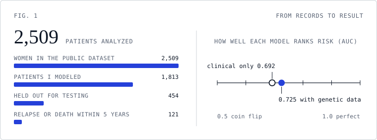
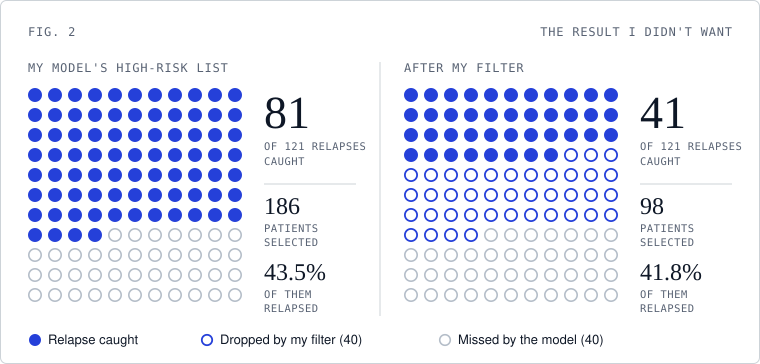

# Breast cancer risk stratification for vaccine trial planning

A student research project about one question: when a breast cancer vaccine is ready for a larger trial, who should be enrolled? I built two models that rank patients by their risk of relapse within five years. Then I tested an idea of my own for choosing a trial group. The idea did not work, and I report that here as a negative result.

**Status:** completed September 2026 and submitted to the AMIA 2026 High School Scholars program. A decision is pending. This page is a summary. The paper, the code and the data are not posted here.

## The question

In 2026, [a study in Nature](https://doi.org/10.1038/s41586-025-10004-2) reported that an individualized mRNA vaccine produced lasting immune responses in a small group of patients with triple-negative breast cancer. Any future trial has to choose who to enroll. I asked two questions.

1. Does adding genetic data to the standard clinical picture predict relapse within five years better?
2. Can a filter based on antigen presentation, meaning how visible a tumor is to the immune system, pick a better group for a trial?

## The data

[METABRIC](https://www.cbioportal.org/study/summary?id=brca_metabric) is a public, de-identified research dataset of 2,509 women with breast cancer, diagnosed in the UK and Canada between 1977 and 2005.

| Step | Patients |
|---|---|
| Women in the public dataset | 2,509 |
| Patients I modeled | 1,813 |
| Used to build the models | 1,359 |
| Held out for testing | 454 |
| Relapse or death from the disease within five years, in the test group | 121 |

No patient data is stored in this repository.

## The two models

| Model | What it uses |
|---|---|
| 1. Clinical only | Age, tumor size, lymph nodes, grade, and hormone and HER2 receptor status |
| 2. Clinical plus genetic | Everything in Model 1, plus nine gene-activity scores and the tumor's mutation count |

The nine scores are built from 68 genes that cover immune activity, antigen presentation, proliferation and receptors. Both models were tested on the 454 patients they had never seen, with confidence intervals from 1,000 resamples.

## Result 1: genetic data helped, modestly

AUC measures how well a model ranks who will relapse. A coin flip scores 0.5 and a perfect ranking scores 1.0. Adding genetic data raised it from 0.692 to 0.725. The gain is real and modest, and that is how I describe it. In the triple-negative subgroup there was no improvement.

## Result 2: my filter failed

| | Model's high-risk list | After my filter |
|---|---|---|
| Patients selected | 186 | 98 |
| Relapses caught, out of 121 | 81 | 41 |
| Share of the selected group who relapsed | 43.5% | 41.8% |

A filter that worked would have raised the share of the selected group who relapsed. Mine did not. It left out 40 patients whose relapses the model had correctly flagged, and the smaller group was no riskier than the larger one. I reported it as a negative result.

My biggest lesson: a useful research result can show why an appealing assumption needs more testing.

## Limits

- All results come from one dataset.
- The patients were diagnosed between 1977 and 2005, so the results may not carry over to patients treated today.
- The gain from genetic data was modest, and it did not appear in the triple-negative subgroup, the group the vaccine study was about.
- The test group had 454 patients and 121 relapses. A larger group could shift the numbers.
- This is a research exercise. It is not a clinical tool and should not guide anyone's care.

## My role

Lead student researcher on a mentored project. I built the models, ran the tests and wrote the first draft.

## Related

- [Healthcare AI agents](https://github.com/eeshabh/agents): 27 agents I built as a summer intern
- [Portfolio](https://eeshabh.github.io)
